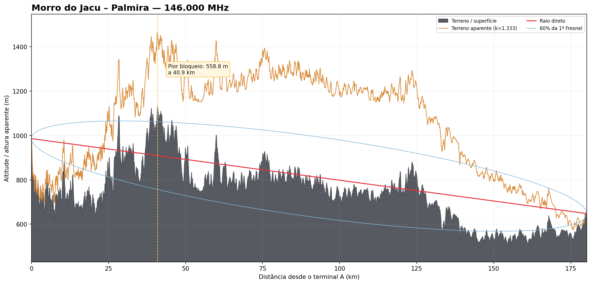
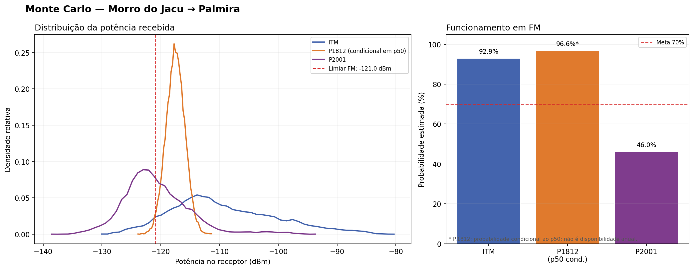

# Radio Link Planner 0.1

Protótipo científico local para análise de enlaces terrestres de
radioamadorismo em VHF e UHF. O programa calcula a geometria do percurso,
executa modelos de propagação independentes, aplica Monte Carlo às
incertezas e gera um relatório rastreável.

Esta versão reúne o **motor científico de linha de comando** e um primeiro
MVP desktop. Ela não depende de servidor próprio e ainda não possui a
interface cartográfica planejada para o produto final.

## O que já funciona

- perfil de terreno Copernicus GLO-30 ou CSV importado;
- curvatura terrestre com fator k configurável;
- primeira zona de Fresnel e obstruções críticas;
- ITM 1.3 oficial da NTIA em modo ponto a ponto;
- ITU-R P.1812-8;
- ITU-R P.2001-6, inclusive em VHF;
- orçamento bidirecional do enlace;
- curvas temporais de ITM e P.2001;
- Monte Carlo reproduzível sem duplicar a variabilidade atmosférica;
- limiares editáveis para FM, SSB, CW, APRS e LoRa;
- classificação, confiança e recomendações;
- JSON, Markdown, HTML e gráficos técnicos.

## Instalação para desenvolvimento

```bash
python -m venv .venv
.venv/bin/python -m pip install -e ".[dev,plots,geo,models]"
.venv/bin/python scripts/build_itm.py
.venv/bin/python scripts/bootstrap_itu_data.py
```

No Windows, ative o ambiente com `.venv\Scripts\activate` e use
`python` no lugar de `.venv/bin/python`.

Os mapas digitais integrais da ITU não são incluídos neste repositório. O
script `bootstrap_itu_data.py` baixa os componentes diretamente da ITU para a
instalação local do usuário.

## Executar o caso de referência

```bash
radio-link analyze examples/morro_jacu_palmira.json \
  --output results/morro_jacu_palmira
```

Ou, sem instalar o comando:

```bash
PYTHONPATH=src python -m radiolink analyze \
  examples/morro_jacu_palmira.json \
  --output results/morro_jacu_palmira
```

## MVP desktop para Windows

O pacote portátil `RadioLinkPlanner-MVP-Windows-x64.zip` é produzido
automaticamente pelo workflow **Windows MVP**. Depois de descompactar, execute
`RadioLinkPlanner.exe`; não é necessário instalar Python.

Na primeira análise, o aplicativo precisa de internet para obter os produtos
digitais integrais diretamente da ITU. Eles não são redistribuídos no ZIP.
Depois desse primeiro download, as análises podem ser repetidas offline.

O MVP permite:

- executar por duplo clique, sem terminal;
- analisar o caso real Morro do Jacu–Palmira já incluído;
- selecionar outro projeto JSON e sua pasta de resultados;
- escolher o número de execuções Monte Carlo;
- gerar e abrir o relatório HTML e os gráficos técnicos.

O pacote é uma pasta portátil, não um instalador. Todos os arquivos extraídos
devem permanecer juntos e em uma pasta gravável pelo usuário. A interface
cartográfica e a criação visual de novos enlaces pertencem à próxima etapa.

Para executar a interface durante o desenvolvimento:

```bash
radio-link-desktop
```

Arquivos gerados:

- `result.json`: resultados completos e rastreáveis;
- `summary.md`: parecer técnico;
- `report.html`: relatório visual local;
- `profile.png`: relevo, raio direto, curvatura e Fresnel;
- `monte_carlo.png`: comparação probabilística dos modelos.

## Demonstração reproduzível

O diretório [`demo-output`](demo-output) contém a saída completa gerada pelo
caso Morro do Jacu–Palmira. Os números abaixo não são valores ilustrativos:
foram produzidos pelos três modelos durante a validação da versão 0.1.





## Testes

```bash
pytest
```

Os testes geométricos e de orçamento não exigem internet. Os ensaios completos
dos três modelos são executados quando os componentes opcionais foram
instalados.

## Estado científico da 0.1

O programa separa três perguntas que calculadoras simples costumam misturar:

1. **qual é a perda mediana?**
2. **qual é a perda em determinado percentual de tempo?**
3. **qual é a chance de o equipamento real superar o limiar, considerando
   incertezas?**

ITM e P.2001 fornecem curvas temporais completas. A P.1812 é usada como
comparação independente até 50% do tempo e não é extrapolada para
disponibilidades superiores.

Consulte [docs/scientific-scope.md](docs/scientific-scope.md) para limitações,
hipóteses e critérios de classificação.
