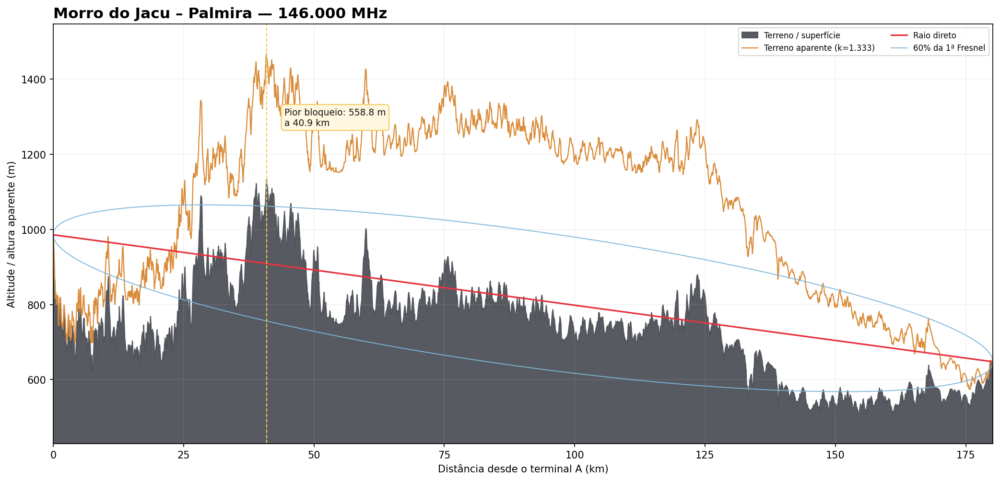
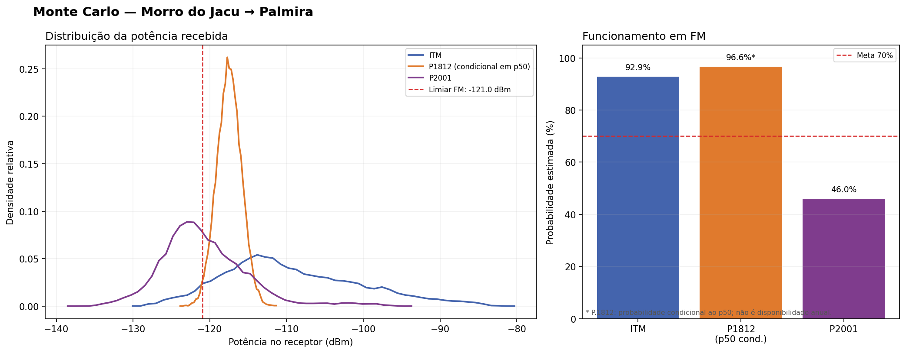

# Radio Link Planner

[English](README.md) | **Português (Brasil)**

Ferramenta local de planejamento de **enlaces terrestres VHF/UHF ponto a ponto e cobertura**. Reúne perfis de terreno, modelos de propagação, orçamento bidirecional, análise de incertezas e relatórios técnicos rastreáveis. O repositório contém interface desktop para Windows e motor científico de linha de comando.

**Autor:** Mario Pin, PU2PTU · **Aplicativo:** 0.5.1

## O que faz

| Área | Recursos |
| --- | --- |
| Enlace ponto a ponto | Configure duas estações, rádios e meta de disponibilidade; examine relevo, curvatura, primeira zona de Fresnel, obstruções, perdas e margens nos dois sentidos. |
| Modelos | Compare **NTIA ITM 1.3**, **ITU-R P.1812-8** e **ITU-R P.2001-6** onde aplicável. A P.1812 cobre percentuais de tempo de 1–50% e não é extrapolada para disponibilidades maiores. |
| Cobertura | Execute P.1812 para cada centro de célula a partir de 250 m, com perfil Copernicus GLO-30 próprio. Mostre heatmap e contornos de margem 0/+3/+6/+12 dB. |
| Incerteza | Monte Carlo reproduzível para equipamentos e instalação, sem somar uma segunda variabilidade atmosférica arbitrária. |
| Trabalho | Novo/Abrir/Salvar projetos, seleção no mapa, estimativa de tempo/memória, cancelamento e retomada; reutilização da perda física quando mudam só parâmetros do orçamento. |
| Saídas | JSON, Markdown, HTML, PDF, gráficos de terreno e Monte Carlo, mapa interativo de cobertura e metadados científicos. |

A interface oferece português, inglês, espanhol, francês e alemão. Os cálculos são locais. Para o seletor de coordenadas e os relatórios, o aplicativo pode servir páginas temporariamente em **127.0.0.1**, somente na própria máquina.

## Hardware e dados de entrada

**Não há montagem eletrônica nem pinagem.** O programa planeja enlaces; ele não controla um transmissor. Para representar uma estação real, obtenha dados medidos ou especificados de **cada ponta**:

| Entrada | Exemplo / significado |
| --- | --- |
| Local | Latitude/longitude digitadas ou escolhidas no mapa. |
| Antena | Altura sobre o terreno, ganho em dBi, polarização e apontamento. |
| Rádio e linha | Potência de transmissão, perdas de cabo/conectores e ruído/limiar do receptor. |
| Meta | Frequência, modo (FM, SSB, CW, APRS ou LoRa) e disponibilidade desejada. |
| Relevo | Blocos **Copernicus GLO-30** baixados ou perfil CSV fornecido explicitamente. |

Os campos descrevem a instalação proposta; o programa não mede ganho da antena, ruído local ou perdas dos cabos. O primeiro download de relevo e dos mapas digitais da ITU para uma nova área exige internet. O cache permite repetir cálculos dos mesmos locais sem rede. Os mosaicos OpenStreetMap servem à visualização e não entram no cálculo de propagação.

## Instalação e bibliotecas

Para uso comum no Windows, obtenha o **instalador x64 ou ZIP portátil**, quando disponível, em [Releases](https://github.com/mariopin80/Radio-Link-Planner/releases). O aplicativo empacotado inclui suas dependências Python; no ZIP mantenha os arquivos juntos. Não é necessário Python separado para o pacote pronto.

Para desenvolver ou rodar pelos fontes, use **Python 3.10+** e os grupos opcionais de [`pyproject.toml`](pyproject.toml). É necessário compilador C++17 para construir a biblioteca NTIA ITM incluída (`MSVC cl` no Developer Command Prompt do Windows); Git é necessário para obter os pacotes Py1812/Py2001 fixados. Dependências básicas: **NumPy, Pydantic, ReportLab**; extras: **Matplotlib** (gráficos), **Rasterio** (terreno), **Py1812/Py2001** (modelos), **PyWebView/PyInstaller** (desktop/empacotamento) e **pytest/pypdf** (desenvolvimento). No Windows, use o Developer Command Prompt com MSVC disponível:

```bat
py -3 -m venv .venv
.venv\Scripts\python.exe -m pip install -e ".[dev,plots,geo,models,desktop]"
.venv\Scripts\python.exe scripts/build_itm.py
.venv\Scripts\python.exe scripts/bootstrap_itu_data.py
```

Execute os scripts em um terminal de desenvolvimento apropriado. `bootstrap_itu_data.py` obtém produtos digitais oficiais da ITU para uso local; **os mapas completos não estão no repositório**. Para uso somente em linha de comando, o extra `desktop` pode ser omitido, mantendo modelos e dados necessários à análise escolhida.

## Manual da interface

### Primeiro enlace ponto a ponto

1. Abra `RadioLinkPlanner.exe`, escolha **Enlace ponto a ponto** e crie um projeto. Digite as coordenadas das duas estações ou escolha-as no mapa.
2. Informe frequência, modo, polarização, disponibilidade, altura/ganho das antenas, perdas de linha, potências e limiares dos receptores de cada terminal.
3. Na aba **Análise e resultados**, selecione pasta de saída e número de rodadas Monte Carlo; clique **Obter terreno e analisar**. O programa baixa e guarda em cache os dados faltantes antes do cálculo.
4. Use **Mapa e relatório** para examinar percurso, relevo, Fresnel, comparação entre modelos, margens e recomendações. Salve o projeto para repetir ou editar.

### Mapa de cobertura

1. Escolha **Mapa de cobertura**, informe estação transmissora e receptor de referência, raio de **50–500 km** e grade rápida, recomendada, detalhada ou personalizada.
2. Confira previsão de células, memória e tempo, e inicie. Cada célula a pelo menos 250 m tem percurso próprio em P.1812; as mais próximas usam perda em espaço livre e são declaradas separadamente.
3. Acompanhe o progresso. Se cancelar, repita os mesmos parâmetros físicos e a pasta de saída para retomar blocos prontos. Alterar só potência, ganho, perdas de linha ou sensibilidade permite reutilizar a perda calculada; alterar percurso ou modelo exige novo cálculo.
4. Abra heatmap, contornos e parecer técnico.

Raios grandes podem levar horas e ocupar bastante disco mesmo com número parecido de células. O perfil de terreno é amostrado nominalmente a 30 m, independentemente do tamanho das células. Os resultados ficam no perfil do usuário; caches de relevo e ITU em `%LOCALAPPDATA%\RadioLinkPlanner\` no Windows.

## Linha de comando e exemplos de saída

O exemplo Morro do Jacu–Palmira aponta para um perfil de terreno incluído e pode ser executado sem obter outro perfil:

```sh
radio-link analyze examples/morro_jacu_palmira.json --output results/morro_jacu_palmira
```

A CLI aceita `--runs`, `--no-plots` e `--print-json`. `radio-link-desktop` inicia a interface no ambiente de desenvolvimento. Os arquivos de demonstração estão em [`demo-output/`](demo-output/):





| Saída do enlace | Conteúdo |
| --- | --- |
| `result.json`, `summary.md` | Resultados completos e parecer técnico. |
| `report.html`, `relatorio_enlace.pdf` | Relatório visual e relatório técnico imprimível. |
| `profile.png`, `monte_carlo.png` | Relevo/Fresnel e comparação probabilística. |

Para cobertura há ainda `coverage_project.json`, grades `.npy` de margem/perda, JSON de propagação e metadados, PNG de heatmap/overlay, GeoJSON dos contornos e relatórios HTML/PDF. A demonstração é uma saída registrada; o motor atual pode produzir números diferentes conforme algoritmos e entradas evoluam.

## Escopo científico

O foco da interface é **30–3000 MHz** e percursos terrestres de **3–1000 km**. O perfil automático assume zona terrestre interior e não inclui vegetação/edificações; trajetos costeiros ou sobre água exigem revisão do `zone_code`. O Monte Carlo atual não amostra erro do DEM nem de altura. Trate as margens e comparações como estimativas de engenharia e confronte-as com parâmetros medidos e observações de campo. Consulte [escopo científico](docs/scientific-scope.md) e [caso de referência](tests/reference/morro_jacu_palmira/reference_notes.md).

Componentes e dados de terceiros mantêm seus próprios avisos, inclusive [`vendor/`](vendor/) e as fontes oficiais ITU/Copernicus. Este repositório não apresenta um arquivo de licença geral do projeto.
